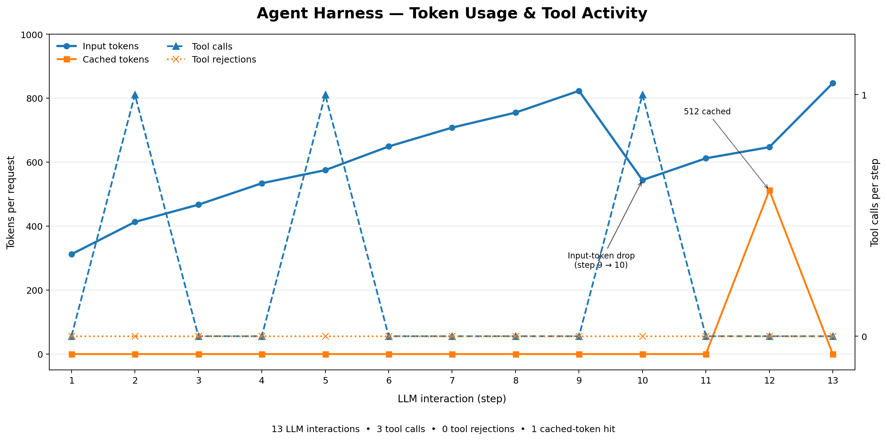

# Basic Agent

This is a simple agent which can hold a conversation, execute basic tools and compact its conversation history when the configured threshold is reached. For this run, compaction threshold is deliberately kept at `0.1` to test compaction without needing a very large conversation.

## Interesting Behaviours

### Conversation Compaction

One useful observation is that the input tokens were rising as the conversation progressed, but then dropped from `823` to `544` tokens between two LLM interactions.

```logs
2026-11-08 23:44:10,181 | INFO     | 57650e260282401897859562bab4c008 | app.140436391667248.application | Input tok; 823, Cached tok: 0
2026-11-08 23:44:10,723 | DEBUG    | 2c035cdcb81e4f59aeb15747992da969 | app.140436391667248.application | Query sent to the model.
2026-11-08 23:44:11,271 | INFO     | 2c035cdcb81e4f59aeb15747992da969 | app.140436391667248.application | Input tok; 544, Cached tok: 0
```

This is consistent with conversation compaction. Keep in mind the threshold for this test is only `0.1`, meaning compaction can be triggered when the reported input tokens reach `800` (10% of the configured 8000 token context budget). The logs show the token drop, but do not separately log the compaction operation itself.

### Agent can Handle Different Tasks

The agent was given some project details about `Atlas` and `Orion`, and was also asked to make tool calls in between. It was able to continue responding to normal messages and execute tools when required.

For example, when asked about the weather, it called `get_weather`:

```logs
2026-11-08 23:44:06,703 | INFO     | cd679ae1b1de4c8196570cb917ced647 | app.140436391667248.application | Input tok; 413, Cached tok: 0
2026-11-08 23:44:06,704 | DEBUG    | cd679ae1b1de4c8196570cb917ced647 | app.140436391667248.application | Executing tool calls...
2026-11-08 23:44:06,704 | DEBUG    | cd679ae1b1de4c8196570cb917ced647 | app.140436391667248.application | Executing tool call: get_weather
2026-11-08 23:44:06,704 | DEBUG    | cd679ae1b1de4c8196570cb917ced647 | app.140436391667248.application | Query sent to the model.
LLM Reply> **Patiala – Weather Update**

- **Condition:** Sunny
- **Temperature:** 28 °C
```

It also executed `list_directory` and returned the dummy directory listing:

```logs
2026-11-08 23:44:07,935 | DEBUG    | 8954a917003f47779afad96b63d09974 | app.140436391667248.application | Executing tool calls...
2026-11-08 23:44:07,935 | DEBUG    | 8954a917003f47779afad96b63d09974 | app.140436391667248.application | Executing tool call: list_directory
2026-11-08 23:44:07,936 | DEBUG    | 8954a917003f47779afad96b63d09974 | app.140436391667248.application | Query sent to the model.
LLM Reply> /workspace/atlas contains:
- main.py
- helpers.py
- constants.py
```

The `list_directory` tool in this example returns dummy entries. Unlike the File System Agent, this example does not demonstrate real workspace filesystem access.

### Agent can Preserve Relevant Context

Another useful observation is that the model continued to distinguish the two projects and their respective technology stacks.

```logs
LLM Reply> Got it—Orion is a separate project using C++ and gRPC. I'll keep that distinction clear.
```

Later it summarized the project details:

```logs
LLM Reply> **Atlas (Java/Spring Boot)**
- **Stack:** Spring Boot + PostgreSQL + Docker
- **Database:** PostgreSQL (replaced MySQL)
- **Migrations:** Flyway
- **Codebase:** `/workspace/atlas` (contains `main.py`, `helpers.py`, `constants.py` – note the current folder layout; actual Java code resides under `src/main/java`)

**Orion (C++ / gRPC)**
- **Stack:** C++ with gRPC for RPC services
- **Deployment:** Docker (for containerized distribution)
- **Other tech choices:** No database was specified; focus is on the gRPC service layer.
```

It also answered that the first weather location asked about was **Patiala**, despite there being another weather request for Jaipur in between.

This demonstrates context retention in this run. However, it does not independently establish that every detail was retained specifically through compaction rather than through the remaining messages.

## What's established?

| Test | Result |
| :--- | :--- |
| Normal conversation | ✅ Passed |
| Tool calling (`get_weather`) | ✅ Passed |
| Tool calling (`list_directory`) | ✅ Passed |
| Continue conversation after tool calls | ✅ Passed |
| Preserve separate project details | ✅ Passed |
| Recall the first weather location | ✅ Passed |
| Input token reduction consistent with compaction | ✅ Observed |
| Tool call rejections | None observed |

## Prompt Caching (provider dependent)

Prompt Caching did not show meaningful consistent caching in this run. There was only one reported cache hit of `512` tokens, despite the conversation growing over multiple interactions. Keep in mind that the low compaction threshold also means the message history may be rewritten during the run. In any case, cache behavior depends on the LLM Provider and cannot be fully controlled by the client side harness.



`Groq` is the LLM provider for the above plot and the model is `OpenAI/GPT-OSS-20b`.

### Specifications for this run

| Parameter | Value |
| :--- | :--- |
| Provider | `Groq` |
| Endpoint | https://api.groq.com/openai/v1 |
| Model | `openai/gpt-oss-20b` |
| Context Window (tok) | 8000 |
| Compaction Threshold | 0.1 |
| Turns to preserve | 2 |

## Complete logs of the run

The exact invocation command and user prompts were not included in the supplied log extract. Below are the available logs, with the interaction order kept as provided.

```logs
2026-11-08 23:44:05,610 | DEBUG    | 7775e1bb2da9447195a68cf152aa3680 | app.140436391667248.application | Query sent to the model.
LLM Reply> Got it! Atlas runs on Spring Boot with a PostgreSQL database, all packaged in Docker. I'll keep those details in mind. Let me know how I can help next.
2026-11-08 23:44:06,530 | INFO     | 7775e1bb2da9447195a68cf152aa3680 | app.140436391667248.application | Input tok; 312, Cached tok: 0
2026-11-08 23:44:06,530 | DEBUG    | cd679ae1b1de4c8196570cb917ced647 | app.140436391667248.application | Query sent to the model.
2026-11-08 23:44:06,703 | INFO     | cd679ae1b1de4c8196570cb917ced647 | app.140436391667248.application | Input tok; 413, Cached tok: 0
2026-11-08 23:44:06,704 | DEBUG    | cd679ae1b1de4c8196570cb917ced647 | app.140436391667248.application | Executing tool calls...
2026-11-08 23:44:06,704 | DEBUG    | cd679ae1b1de4c8196570cb917ced647 | app.140436391667248.application | Executing tool call: get_weather
2026-11-08 23:44:06,704 | DEBUG    | cd679ae1b1de4c8196570cb917ced647 | app.140436391667248.application | Query sent to the model.
LLM Reply> **Patiala – Weather Update**

- **Condition:** Sunny
- **Temperature:** 28 °C

Let me know if you need anything else!
2026-11-08 23:44:07,150 | INFO     | cd679ae1b1de4c8196570cb917ced647 | app.140436391667248.application | Input tok; 467, Cached tok: 0
2026-11-08 23:44:07,151 | DEBUG    | 9038b6095d6e4f7b99e505f93e7ed580 | app.140436391667248.application | Query sent to the model.
LLM Reply> Acknowledged – Atlas uses PostgreSQL (not MySQL).
2026-11-08 23:44:07,621 | INFO     | 9038b6095d6e4f7b99e505f93e7ed580 | app.140436391667248.application | Input tok; 534, Cached tok: 0
2026-11-08 23:44:07,621 | DEBUG    | 8954a917003f47779afad96b63d09974 | app.140436391667248.application | Query sent to the model.
2026-11-08 23:44:07,935 | INFO     | 8954a917003f47779afad96b63d09974 | app.140436391667248.application | Input tok; 575, Cached tok: 0
2026-11-08 23:44:07,935 | DEBUG    | 8954a917003f47779afad96b63d09974 | app.140436391667248.application | Executing tool calls...
2026-11-08 23:44:07,935 | DEBUG    | 8954a917003f47779afad96b63d09974 | app.140436391667248.application | Executing tool call: list_directory
2026-11-08 23:44:07,936 | DEBUG    | 8954a917003f47779afad96b63d09974 | app.140436391667248.application | Query sent to the model.
LLM Reply> /workspace/atlas contains:
- main.py
- helpers.py
- constants.py
2026-11-08 23:44:08,507 | INFO     | 8954a917003f47779afad96b63d09974 | app.140436391667248.application | Input tok; 649, Cached tok: 0
2026-11-08 23:44:08,507 | DEBUG    | 70dfd36e1d964cb1a679f23026a2ecb9 | app.140436391667248.application | Query sent to the model.
LLM Reply> Understood – Atlas will use Flyway for database migrations.
2026-11-08 23:44:09,185 | INFO     | 70dfd36e1d964cb1a679f23026a2ecb9 | app.140436391667248.application | Input tok; 708, Cached tok: 0
2026-11-08 23:44:09,185 | DEBUG    | 4746db4271d340e2802699bbf22e95e0 | app.140436391667248.application | Query sent to the model.
LLM Reply> - **Project name:** Atlas
- **Database:** PostgreSQL
- **Migration tool:** Flyway
2026-11-08 23:44:09,692 | INFO     | 4746db4271d340e2802699bbf22e95e0 | app.140436391667248.application | Input tok; 755, Cached tok: 0
2026-11-08 23:44:09,692 | DEBUG    | 57650e260282401897859562bab4c008 | app.140436391667248.application | Query sent to the model.
LLM Reply> Got it—Orion is a separate project using C++ and gRPC. I'll keep that distinction clear.
2026-11-08 23:44:10,181 | INFO     | 57650e260282401897859562bab4c008 | app.140436391667248.application | Input tok; 823, Cached tok: 0
2026-11-08 23:44:10,723 | DEBUG    | 2c035cdcb81e4f59aeb15747992da969 | app.140436391667248.application | Query sent to the model.
2026-11-08 23:44:11,271 | INFO     | 2c035cdcb81e4f59aeb15747992da969 | app.140436391667248.application | Input tok; 544, Cached tok: 0
2026-11-08 23:44:11,271 | DEBUG    | 2c035cdcb81e4f59aeb15747992da969 | app.140436391667248.application | Executing tool calls...
2026-11-08 23:44:11,272 | DEBUG    | 2c035cdcb81e4f59aeb15747992da969 | app.140436391667248.application | Executing tool call: get_weather
2026-11-08 23:44:11,272 | DEBUG    | 2c035cdcb81e4f59aeb15747992da969 | app.140436391667248.application | Query sent to the model.
LLM Reply> **Weather in Jaipur:** Sunny, 28 °C.
2026-11-08 23:44:11,807 | INFO     | 2c035cdcb81e4f59aeb15747992da969 | app.140436391667248.application | Input tok; 612, Cached tok: 0
2026-11-08 23:44:11,807 | DEBUG    | ec44d0a5e31f441687093c3dc65c4c9e | app.140436391667248.application | Query sent to the model.
LLM Reply> **Atlas (Java/Spring Boot)**
- **Stack:** Spring Boot + PostgreSQL + Docker
- **Database:** PostgreSQL (replaced MySQL)
- **Migrations:** Flyway
- **Codebase:** `/workspace/atlas` (contains `main.py`, `helpers.py`, `constants.py` – note the current folder layout; actual Java code resides under `src/main/java`)

**Orion (C++ / gRPC)**
- **Stack:** C++ with gRPC for RPC services
- **Deployment:** Docker (for containerized distribution)
- **Other tech choices:** No database was specified; focus is on the gRPC service layer.
2026-11-08 23:44:10,066 | INFO     | ec44d0a5e31f441687093c3dc65c4c9e | app.140436391667248.application | Input tok; 647, Cached tok: 512
2026-11-08 23:44:10,067 | DEBUG    | 2c788febc130407ea62f5704c5b9fc46 | app.140436391667248.application | Query sent to the model.
LLM Reply> The first weather location you asked about was **Patiala**.
2026-11-08 23:44:13,706 | INFO     | 2c788febc130407ea62f5704c5b9fc46 | app.140436391667248.application | Input tok; 847, Cached tok: 0
```
