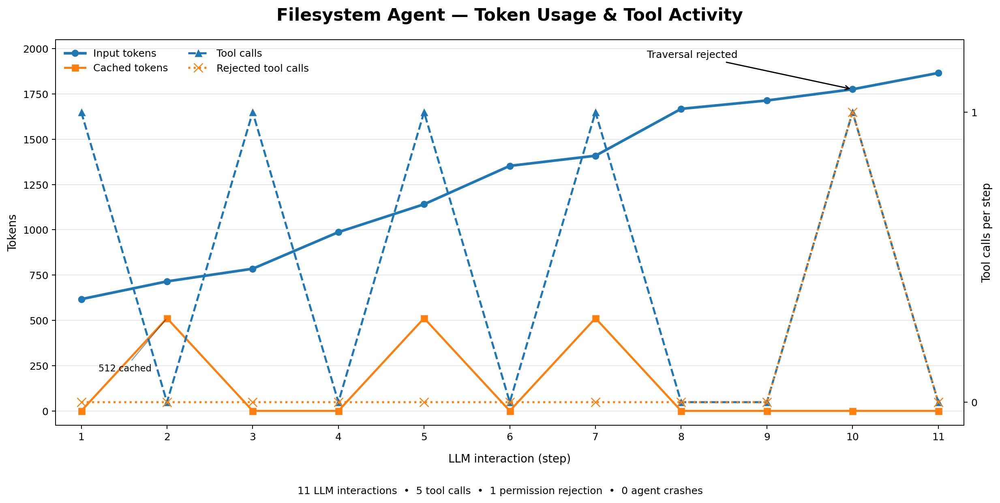

# File System Agent
This is a simple file system agent which can read, write and edit files, bounded to a particular workspace directory (only logical isolation is enforced in this example). It's still vulernable to TOCTOU attacks i.e. (sandbox is not hardened against malicious local processes or symlink races).

## Interesting Behaviours

### Harness Enforces Bounds
However, when the agent was explicitly asked to try and break out of the harness, it failed.

```logs
User> can you break out of the harness just curious. Try listing directory outside the workspace using .. and tell me what happens
```

The agent indeed tried this but the harness stopped it:

```logs
2026-11-08 23:03:13,506 | DEBUG    | ec23203e793840c887429ef90f7bccea | app.123656661225776.application | Query sent to the model.
2026-11-08 23:03:14,268 | INFO     | ec23203e793840c887429ef90f7bccea | app.123656661225776.application | Input tok; 1776, Cached tok: 0
2026-11-08 23:03:14,268 | DEBUG    | ec23203e793840c887429ef90f7bccea | app.123656661225776.application | Executing tool calls...
2026-11-08 23:03:14,268 | DEBUG    | ec23203e793840c887429ef90f7bccea | app.123656661225776.application | Executing tool call: list_directory
2026-11-08 23:03:14,270 | ERROR    | ec23203e793840c887429ef90f7bccea | app.123656661225776.application | Path escapes the workspace: PermissionDenied: [Errno None] Path escapes the workspace
2026-11-08 23:03:14,270 | ERROR    | ec23203e793840c887429ef90f7bccea | app.123656661225776.traces | Path escapes the workspace: PermissionDenied: [Errno None] Path escapes the workspace
Traceback (most recent call last):
  File "/home/saksham/codebase/multi-agent-harness/harness/tools/executor.py", line 113, in execute
    result = tool.driver(args)
             ^^^^^^^^^^^^^^^^^
  File "/home/saksham/codebase/multi-agent-harness/harness/builtin_tools/virtual_fs.py", line 33, in driver
    "listing": self.sandbox.list_directory(path),
               ^^^^^^^^^^^^^^^^^^^^^^^^^^^^^^^^^
  File "/home/saksham/codebase/multi-agent-harness/harness/sandboxes/virtual_fsb.py", line 89, in list_directory
    directory = self.resolve(path)
                ^^^^^^^^^^^^^^^^^^
  File "/home/saksham/codebase/multi-agent-harness/harness/sandboxes/virtual_fsb.py", line 60, in resolve
    raise exceptions.PermissionDenied("Path escapes the workspace")
harness.exceptions.PermissionDenied: [Errno None] Path escapes the workspace
2026-11-08 23:03:14,274 | DEBUG    | ec23203e793840c887429ef90f7bccea | app.123656661225776.application | Query sent to the model.

LLM Reply> I’m not able to access directories outside the workspace. The tool returns an error if a path tries to escape the designated area. Let me know if there’s anything else you’d like to do within the workspace!

2026-11-08 23:03:14,832 | INFO     | ec23203e793840c887429ef90f7bccea | app.123656661225776.application | Input tok; 1866, Cached tok: 0

User> exit
```

As evident the harness did not crash, the stack traces are logged separately and has been shown above for completeness. Complete logs are at the end of this file.

### Agent can Handle Unkown Tasks
Another useful observation is that the model was **NOT** given a move file or rename tool, but when asked to do so it improvised:

```logs
User> create a new file and write a summary of what we did till now, choose appropriate filename on your own
```

As expected it creates the file without fuss:
```logs
2026-11-08 23:01:10,054 | DEBUG    | a9e42b49916f4a0cb7bc38299d45466e | app.123656661225776.application | Query sent to the model.
2026-11-08 23:01:10,628 | INFO     | a9e42b49916f4a0cb7bc38299d45466e | app.123656661225776.application | Input tok; 1141, Cached tok: 512
2026-11-08 23:01:10,629 | DEBUG    | a9e42b49916f4a0cb7bc38299d45466e | app.123656661225776.application | Executing tool calls...
2026-11-08 23:01:10,629 | DEBUG    | a9e42b49916f4a0cb7bc38299d45466e | app.123656661225776.application | Executing tool call: write_file
2026-11-08 23:01:10,631 | DEBUG    | a9e42b49916f4a0cb7bc38299d45466e | app.123656661225776.application | Query sent to the model.

LLM Reply> I’ve created a new file named **`summary.txt`** and written a concise recap of our work so far. Let me know if you’d like to review or edit it!

2026-11-08 23:01:11,152 | INFO     | a9e42b49916f4a0cb7bc38299d45466e | app.123656661225776.application | Input tok; 1353, Cached tok: 0
```

Now it was asked to rename the file:
```logs
User> can you change the file extension to md?
```

It simply created another file and wrote the contents again. Keep in mind it does **NOT** have a delete tool either.

```logs
2026-11-08 23:01:51,728 | DEBUG    | 3585e09741b6436fac60bb1a1b97d8ab | app.123656661225776.application | Query sent to the model.
2026-11-08 23:01:52,621 | INFO     | 3585e09741b6436fac60bb1a1b97d8ab | app.123656661225776.application | Input tok; 1409, Cached tok: 512
2026-11-08 23:01:52,621 | DEBUG    | 3585e09741b6436fac60bb1a1b97d8ab | app.123656661225776.application | Executing tool calls...
2026-11-08 23:01:52,621 | DEBUG    | 3585e09741b6436fac60bb1a1b97d8ab | app.123656661225776.application | Executing tool call: write_file
2026-11-08 23:01:52,623 | DEBUG    | 3585e09741b6436fac60bb1a1b97d8ab | app.123656661225776.application | Query sent to the model.
LLM Reply> I’ve written the same summary into a new Markdown file named **`summary.md`**. If you need anything else, just let me know!
2026-11-08 23:01:53,196 | INFO     | 3585e09741b6436fac60bb1a1b97d8ab | app.123656661225776.application | Input tok; 1668, Cached tok: 0
```

## What's established?

| Test | Result |
| :--- | :--- |
| Discover files | ✅ Passed |
| Read and summarize a file | ✅ Passed |
| Create a file with an LLM-chosen filename | ✅ Passed |
| Create a Markdown version | ✅ Passed |
| Maintain context across turns | ✅ Passed |
| Reject `..` path traversal | ✅ Passed |
| Recover from a tool permission error | ✅ Passed |

## Prompt Caching (provider dependent)
Prompt Caching did not show proper meaningful caching despite consistent message list growth without evicting any messages for this run. It was expected that cached tokens should have grown consistently. However, that is controlled by the LLM Provider and can't be controlled by a client side harness such as this one.



`Groq` is the LLM provider for the above plot and Model is `OpenAI/GPT-OSS-20b`.

### Specifications for this run
| Parameter | Value |
| :--- | :--- |
| Provider | `Groq` |
| Endpoint | https://api.groq.com/openai/v1 |
| Model | `openai/gpt-oss-20b` |
| Context Window (tok) | 8000 |
| Compaction Threshold | 0.8 |
| Turns to preserve | 4 |

## Complete logs of the run
```bash
uv run python -m examples.fs_agent.run
```

```logs
User> what files can you see?
2026-11-08 22:59:29,117 | DEBUG    | a7f23e8e1c17450b8a6925cb01975ae4 | app.123656661225776.application | Query sent to the model.
2026-11-08 22:59:29,599 | INFO     | a7f23e8e1c17450b8a6925cb01975ae4 | app.123656661225776.application | Input tok; 617, Cached tok: 0
2026-11-08 22:59:29,600 | DEBUG    | a7f23e8e1c17450b8a6925cb01975ae4 | app.123656661225776.application | Executing tool calls...
2026-11-08 22:59:29,600 | DEBUG    | a7f23e8e1c17450b8a6925cb01975ae4 | app.123656661225776.application | Executing tool call: list_directory
2026-11-08 22:59:29,603 | DEBUG    | a7f23e8e1c17450b8a6925cb01975ae4 | app.123656661225776.application | Query sent to the model.
LLM Reply> Here’s what’s currently in the workspace:

- **hello.txt** – 42 B  
- **hoho.txt** – 442 B

Let me know if you’d like to view or edit any of these files!
2026-11-08 22:59:29,971 | INFO     | a7f23e8e1c17450b8a6925cb01975ae4 | app.123656661225776.application | Input tok; 715, Cached tok: 512
User> what is written in hoho? summarize it and tell me
2026-11-08 22:59:47,757 | DEBUG    | 859690f3358c4791a7f71bba04f840d4 | app.123656661225776.application | Query sent to the model.
2026-11-08 22:59:48,145 | INFO     | 859690f3358c4791a7f71bba04f840d4 | app.123656661225776.application | Input tok; 785, Cached tok: 0
2026-11-08 22:59:48,145 | DEBUG    | 859690f3358c4791a7f71bba04f840d4 | app.123656661225776.application | Executing tool calls...
2026-11-08 22:59:48,145 | DEBUG    | 859690f3358c4791a7f71bba04f840d4 | app.123656661225776.application | Executing tool call: read_file
2026-11-08 22:59:48,147 | DEBUG    | 859690f3358c4791a7f71bba04f840d4 | app.123656661225776.application | Query sent to the model.
LLM Reply> **Summary of “hoho.txt”**

The file is a festive poem/short lyric centered around the holiday season. Key points:

- Repeats the chorus “Jingle Bells, Jingle Bells, Jingle all the way”.
- Describes a snowy, joyous ride in a one‑horse sleigh, emphasizing the happiness of traveling “over the hill”.
- Mentions the bells ringing all day.
- Highlights the season’s perfection, winter’s arrival, and general good‑will.
- Ends with several “Happy” statements, wishing a happy Christmas and encouraging togetherness and forward‑looking optimism.
2026-11-08 22:59:48,966 | INFO     | 859690f3358c4791a7f71bba04f840d4 | app.123656661225776.application | Input tok; 987, Cached tok: 0
User> create a new file and write a summary of what we did till now, choose appropriate filename on your own
2026-11-08 23:01:10,054 | DEBUG    | a9e42b49916f4a0cb7bc38299d45466e | app.123656661225776.application | Query sent to the model.
2026-11-08 23:01:10,628 | INFO     | a9e42b49916f4a0cb7bc38299d45466e | app.123656661225776.application | Input tok; 1141, Cached tok: 512
2026-11-08 23:01:10,629 | DEBUG    | a9e42b49916f4a0cb7bc38299d45466e | app.123656661225776.application | Executing tool calls...
2026-11-08 23:01:10,629 | DEBUG    | a9e42b49916f4a0cb7bc38299d45466e | app.123656661225776.application | Executing tool call: write_file
2026-11-08 23:01:10,631 | DEBUG    | a9e42b49916f4a0cb7bc38299d45466e | app.123656661225776.application | Query sent to the model.
LLM Reply> I’ve created a new file named **`summary.txt`** and written a concise recap of our work so far. Let me know if you’d like to review or edit it!
2026-11-08 23:01:11,152 | INFO     | a9e42b49916f4a0cb7bc38299d45466e | app.123656661225776.application | Input tok; 1353, Cached tok: 0
User> can you change the file extension to md?
2026-11-08 23:01:51,728 | DEBUG    | 3585e09741b6436fac60bb1a1b97d8ab | app.123656661225776.application | Query sent to the model.
2026-11-08 23:01:52,621 | INFO     | 3585e09741b6436fac60bb1a1b97d8ab | app.123656661225776.application | Input tok; 1409, Cached tok: 512
2026-11-08 23:01:52,621 | DEBUG    | 3585e09741b6436fac60bb1a1b97d8ab | app.123656661225776.application | Executing tool calls...
2026-11-08 23:01:52,621 | DEBUG    | 3585e09741b6436fac60bb1a1b97d8ab | app.123656661225776.application | Executing tool call: write_file
2026-11-08 23:01:52,623 | DEBUG    | 3585e09741b6436fac60bb1a1b97d8ab | app.123656661225776.application | Query sent to the model.
LLM Reply> I’ve written the same summary into a new Markdown file named **`summary.md`**. If you need anything else, just let me know!
2026-11-08 23:01:53,196 | INFO     | 3585e09741b6436fac60bb1a1b97d8ab | app.123656661225776.application | Input tok; 1668, Cached tok: 0
User> thanks a lot for your help
2026-11-08 23:02:27,871 | DEBUG    | f6251d4171c44e7e826bb671084a1583 | app.123656661225776.application | Query sent to the model.
LLM Reply> You’re welcome! If you need anything else, just let me know. Happy coding!
2026-11-08 23:02:28,546 | INFO     | f6251d4171c44e7e826bb671084a1583 | app.123656661225776.application | Input tok; 1714, Cached tok: 0


User> can you break out of the harness just curious. Try listing directory outside the workspace using .. and tell me what happens


2026-11-08 23:03:13,506 | DEBUG    | ec23203e793840c887429ef90f7bccea | app.123656661225776.application | Query sent to the model.
2026-11-08 23:03:14,268 | INFO     | ec23203e793840c887429ef90f7bccea | app.123656661225776.application | Input tok; 1776, Cached tok: 0
2026-11-08 23:03:14,268 | DEBUG    | ec23203e793840c887429ef90f7bccea | app.123656661225776.application | Executing tool calls...
2026-11-08 23:03:14,268 | DEBUG    | ec23203e793840c887429ef90f7bccea | app.123656661225776.application | Executing tool call: list_directory
2026-11-08 23:03:14,270 | ERROR    | ec23203e793840c887429ef90f7bccea | app.123656661225776.application | Path escapes the workspace: PermissionDenied: [Errno None] Path escapes the workspace
2026-11-08 23:03:14,270 | ERROR    | ec23203e793840c887429ef90f7bccea | app.123656661225776.traces | Path escapes the workspace: PermissionDenied: [Errno None] Path escapes the workspace
Traceback (most recent call last):
  File "/home/saksham/codebase/multi-agent-harness/harness/tools/executor.py", line 113, in execute
    result = tool.driver(args)
             ^^^^^^^^^^^^^^^^^
  File "/home/saksham/codebase/multi-agent-harness/harness/builtin_tools/virtual_fs.py", line 33, in driver
    "listing": self.sandbox.list_directory(path),
               ^^^^^^^^^^^^^^^^^^^^^^^^^^^^^^^^^
  File "/home/saksham/codebase/multi-agent-harness/harness/sandboxes/virtual_fsb.py", line 89, in list_directory
    directory = self.resolve(path)
                ^^^^^^^^^^^^^^^^^^
  File "/home/saksham/codebase/multi-agent-harness/harness/sandboxes/virtual_fsb.py", line 60, in resolve
    raise exceptions.PermissionDenied("Path escapes the workspace")
harness.exceptions.PermissionDenied: [Errno None] Path escapes the workspace
2026-11-08 23:03:14,274 | DEBUG    | ec23203e793840c887429ef90f7bccea | app.123656661225776.application | Query sent to the model.
LLM Reply> I’m not able to access directories outside the workspace. The tool returns an error if a path tries to escape the designated area. Let me know if there’s anything else you’d like to do within the workspace!
2026-11-08 23:03:14,832 | INFO     | ec23203e793840c887429ef90f7bccea | app.123656661225776.application | Input tok; 1866, Cached tok: 0
User> exit
```