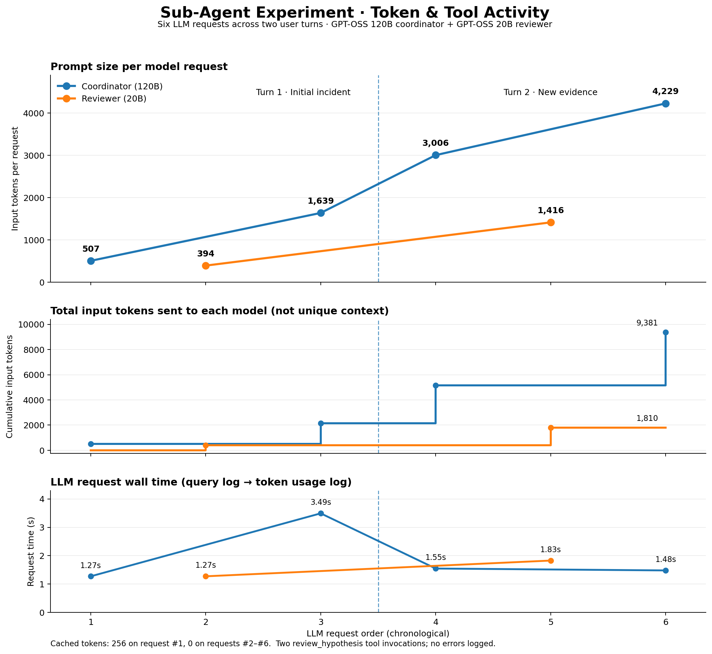

# Sub Agent Experiment

This is a simple multi-agent experiment using a main agent (`openai/gpt-oss-120b`) and a hypothesis reviewing sub-agent (`openai/gpt-oss-20b`). The main agent investigates a Spring Boot production incident and can call the reviewer through an ordinary `review_hypothesis` tool. The reviewer does not have any tools of its own.

Both agents are instances of `SynchronousAgentBase`. The main agent uses the `SCMTTAgent` shortcut (Single Conversation, Multiple Tool Turns) while the reviewer maintains its own messages and runs inside the tool's `driver()`. There is no dedicated orchestrator or agent runner. This example is intended to test agent delegation and context preservation, not whether multi-agent reasoning gives a better root-cause analysis.

## Interesting Behaviours

### Main Agent Can Invoke Another Agent Through a Normal Tool

The main agent was given only one tool: `review_hypothesis`. It called this tool on its own during the incident investigation:

```logs
2026-11-11 17:16:33,644 | DEBUG    | 190c7c9bf5f240f2b0f59829c97a49a7 | app.124670866467984.application | Executing tool call: review_hypothesis
2026-11-11 17:16:33,644 | DEBUG    | fcfafac1e791430d84059ce084e548cc | app.124670866467984.application | Query sent to the model.
2026-11-11 17:16:34,918 | INFO     | fcfafac1e791430d84059ce084e548cc | app.124670866467984.application | Input tok; 394, Cached tok: 0
2026-11-11 17:16:34,918 | DEBUG    | 190c7c9bf5f240f2b0f59829c97a49a7 | app.124670866467984.application | Query sent to the model.
```

The reviewer runs synchronously and returns its output as a normal tool result. The main agent then continues its own `step()` loop and produces the final answer. It does not need a separate orchestration class to achieve this.

### Context is Maintained Across User Turns

The follow-up was given **in the same Python process**, so both agents retained their conversation histories. The initial reviewer request used **394 input tokens**, while the second reviewer request used **1,416 input tokens**. This is consistent with the reviewer having the earlier exchange in its context, as expected from reusing the same agent instance.

The main agent also made use of the previous investigation. Its prompt size increased from **507 → 1,639 → 3,006 → 4,229** tokens across four model requests. These token counts are per request, not the sizes of two agents' combined contexts.

The second turn again delegated to `review_hypothesis`:

```logs
2026-11-11 17:17:10,207 | DEBUG    | db6f1613db504b059ecf517e1a27c488 | app.124670866467984.application | Executing tool call: review_hypothesis
2026-11-11 17:17:10,207 | DEBUG    | 02f7cba7aa26474c9a35545973c651df | app.124670866467984.application | Query sent to the model.
2026-11-11 17:17:12,036 | INFO     | 02f7cba7aa26474c9a35545973c651df | app.124670866467984.application | Input tok; 1416, Cached tok: 0
2026-11-11 17:17:12,036 | DEBUG    | db6f1613db504b059ecf517e1a27c488 | app.124670866467984.application | Query sent to the model.
```

This only demonstrates in-process context persistence. No checkpoint restoration after restarting Python was tested.

### Correlation IDs Are Preserved Across Nested Calls

A new correlation ID is generated for each agent turn. The reviewer receives a separate correlation ID while it is executing, and once the tool finishes, the coordinator's original correlation ID is restored. This works with the existing `turn()` and `correlation_scope()` implementation.

### The Agent Reassesses Its Hypothesis With New Evidence

Initially, the main agent suspected that database connections were being held longer after deployment, causing pool exhaustion. In the second turn, it received HikariCP data (**20 active, 0 idle, 47 waiting**) and PostgreSQL data (**18 sessions idle in transaction for more than 10 minutes**). It consulted the reviewer again and revised its conclusion.

The final answer became too certain that a **connection leak** had occurred. The new evidence supports pool exhaustion and unusually long transactions, but `idle in transaction` does not by itself prove a leaked connection; long-held transactions or delayed cleanup could also explain the observation. This is a reasoning-quality limitation, not a failure of delegation.

## What's established?

| Test | Result |
| :--- | :--- |
| Main agent invokes sub-agent through `review_hypothesis` | ✅ Passed |
| Sub-agent executes synchronously and returns control | ✅ Passed |
| Main agent continues after sub-agent completes | ✅ Passed |
| Separate correlation IDs for nested agent turns | ✅ Passed |
| Main agent preserves its context across user turns | ✅ Passed |
| Sub-agent instance reused for a follow-up | ✅ Passed (in-process) |
| Sub-agent has its own message history | ✅ By construction; not directly dumped in logs |
| Specialist failure handling and recovery | Not tested |
| Checkpoint / restart recovery | Not tested |
| Compaction behaviour | Not triggered in the visible logs |

## Token Usage and Tool Activity



The graph shows **six model requests** across two user turns: four requests to the main agent and two to the reviewer. The dashed vertical line separates the initial investigation from the follow-up. The reviewer is invoked at request **#2** and again at **#5**.

| Metric | Main Agent (120B) | Reviewer (20B) | Total |
| :--- | ---: | ---: | ---: |
| Model requests | 4 | 2 | 6 |
| Summed input tokens (across requests) | 9,381 | 1,810 | 11,191 |
| Cached input tokens reported | 256 | 0 | 256 |
| Tool invocations into reviewer | 2 | — | 2 |

Input-token totals are the sum of prompt tokens supplied to each request, **not unique tokens retained in memory**, and should not be interpreted as total billed tokens because completion-token usage is not included in these logs.

The first user turn took approximately **6.04s** and the second approximately **4.86s** from the first request log to the final token-usage log, excluding user typing time. These are approximate observed wall times, not isolated model generation latency benchmarks. Per-request durations are also plotted.

The underlying data is available in [`subagent_run_metrics.csv`](./subagent_run_metrics.csv).

## Prompt Caching (provider dependent)

Caching was reported on only the first coordinator request (**256 cached tokens**); the other five requests reported **0** cached tokens. Despite the contexts growing across turns, the log does not demonstrate consistent prompt-cache hits. This is controlled by the configured inference provider and its cache policy, not by a guarantee from this harness.

## Specifications for this run

| Parameter | Main Agent | Sub-Agent |
| :--- | :--- | :--- |
| Model | `openai/gpt-oss-120b` | `openai/gpt-oss-20b` |
| Agent implementation | `SCMTTAgent` | `HypothesisReviewerAgent` |
| Tools | `review_hypothesis` | None |
| Compaction Threshold | `0.8` | `0.8` |
| Turns to preserve | `4` | `4` |
| Execution | User-defined `step()` loop | Called inside `ReviewHypothesisTool.driver()` |
| Provider / endpoint | Configured in environment | Configured in environment |
| Context budget | Not set explicitly in the run script | Not set explicitly in the run script |

For the main agent, `TOOL_CALL_PER_TURN_LIMIT = 3` in the script bounds continuing `step()` iterations; this is **not** a strict count of individual tool calls because a single model response can contain multiple tool calls.

## Complete logs of the run

```bash
uv run python -m experimental.subagent.run
```

```logs
$ uv run python -m experimental.subagent.run
User> Investigate the following production incident: A Spring Boot application's API response time increased from approximately 100 ms to 5 seconds shortly after a deployment. Observations: - CPU utilization remains around 20%. - Memory utilization is normal. - PostgreSQL connection-pool utilization is at 100%. - The number of incoming requests has not significantly increased. - No application errors were reported during deployment. Identify the most likely root cause, consider alternative explanations, and consult your technical reviewer beforereaching a conclusion.
2026-11-11 17:16:32,371 | DEBUG    | 190c7c9bf5f240f2b0f59829c97a49a7 | app.124670866467984.application | Query sent to the model.
2026-11-11 17:16:33,644 | INFO     | 190c7c9bf5f240f2b0f59829c97a49a7 | app.124670866467984.application | Input tok; 507, Cached tok: 256
2026-11-11 17:16:33,644 | DEBUG    | 190c7c9bf5f240f2b0f59829c97a49a7 | app.124670866467984.application | Executing tool calls...
2026-11-11 17:16:33,644 | DEBUG    | 190c7c9bf5f240f2b0f59829c97a49a7 | app.124670866467984.application | Executing tool call: review_hypothesis
2026-11-11 17:16:33,644 | DEBUG    | fcfafac1e791430d84059ce084e548cc | app.124670866467984.application | Query sent to the model.
2026-11-11 17:16:34,918 | INFO     | fcfafac1e791430d84059ce084e548cc | app.124670866467984.application | Input tok; 394, Cached tok: 0
2026-11-11 17:16:34,918 | DEBUG    | 190c7c9bf5f240f2b0f59829c97a49a7 | app.124670866467984.application | Query sent to the model.
LLM Reply> **Observed evidence**

| Metric / Observation | Value / Note |
|----------------------|--------------|
| API response time   | ↑ from ~100 ms to ~5 s, starting shortly after the deployment |
| CPU utilization      | ~20 % (unchanged) |
| Memory utilization   | Normal |
| PostgreSQL connection‑pool utilization | **100 %** (pool fully saturated) |
| Incoming request rate| No significant change |
| Deployment errors    | None reported |

**Key facts** – These are directly measured or logged and therefore treated as *observed*.

- The latency increase coincides temporally with the new deployment.  
- System‑level resources (CPU, memory) are not under pressure, so the bottleneck is unlikely to be compute‑bound on the application host.  
- The request volume is stable, eliminating a traffic surge as the primary cause.  
- The DB connection pool is at its maximum capacity, indicating that every request that needs a DB connection is competing for a limited resource.

**Most likely root‑cause hypothesis**

*The deployment introduced a change that caused database connections to be held longer (e.g., an inefficient or altered SQL query, a missing/changed index, or a subtle connection‑leak). This increased the time each request occupied a pool connection, quickly exhausting the PostgreSQL connection pool. With the pool saturated, request‑handling threads blocked while waiting for a free connection, inflating the API response time from ~100 ms to ~5 s.*

**Reasoning**

1. **Pool saturation → blocking** – When the pool is full, any thread that needs a connection must wait. HikariCP (commonly used with Spring Boot) will block the caller up to `connectionTimeout` (default 30 s). A blocked thread adds latency directly to the request path, matching the observed 5‑second tail.
2. **Longer connection hold time** – The only way a fixed‑size pool can become saturated without a traffic increase is if each request holds the connection longer than before. This typically results from:
   - A query that now runs orders of magnitude slower (plan regression, missing index, N+1 pattern).
   - A connection‑leak where the code fails to close a `Connection`/`EntityManager`, gradually reducing the pool’s available slots.
3. **CPU idle** – Because the application is primarily waiting for DB I/O, CPU stays low, consistent with the observed 20 % utilization.
4. **No deployment errors** – The code compiled and started successfully; the issue is functional (runtime DB interaction) rather than a deployment‑script failure.

**Alternative explanations considered**

| Explanation | Why it could fit | Evidence against / missing |
|-------------|------------------|-----------------------------|
| **Network latency / DNS change** between app and DB | Could add round‑trip delay | Would not fully saturate the pool; latency would be additive (~ms), not cause 5 s waits. |
| **PostgreSQL host resource saturation (CPU/I/O)** | DB slowdown could back‑pressure connections | No DB‑side metrics provided; however, pool saturation alone already explains the latency. |
| **Increased background jobs / other services** hitting the DB | More concurrent DB usage would fill pool | Request volume unchanged; no indication of new jobs. |
| **Thread‑pool exhaustion in the app** | Would also increase latency | CPU low, and pool metric directly points to DB connections. |
| **Lock contention or deadlocks in DB** | Could hold connections long | Would typically surface as lock‑wait metrics or errors; not mentioned. |

These alternatives remain possible but are less consistent with the *specific* observation that **connection‑pool utilization is at 100 %** while other resources are idle.

**Confidence level & remaining uncertainties**

- **Confidence:** **Moderate‑high (≈ 75 %)** that the latency is caused by prolonged DB connection hold time leading to pool exhaustion.
- **Uncertainties:**
  1. **Exact nature of the slowdown** – Is it a query‑plan regression, a missing index, or a connection leak?
  2. **Whether the pool truly reached the hard limit** or whether connections were being *waited on* before the limit (e.g., due to long wait‑queues).
  3. **DB‑side resource state** – CPU, I/O, lock stats are not provided; a DB bottleneck could be a contributing factor.

**Recommended next diagnostic steps**

1. **Collect pool‑specific metrics** (e.g., HikariCP `active`, `idle`, `threadsAwaitingConnection`, `connectionAcquireMillis`). Verify wait times and whether threads are queuing.
2. **Enable connection‑leak detection** (`leakDetectionThreshold`) and review logs for any “Connection leak detection” warnings.
3. **Profile the affected endpoints**:
   - Capture the exact SQL statements executed after the deployment.
   - Run `EXPLAIN (ANALYZE, BUFFERS)` on those statements in a staging environment to check for plan changes, full table scans, or missing indexes.
4. **Check PostgreSQL `pg_stat_activity`** for sessions in `waiting` state and for long‑running queries; correlate with request timestamps.
5. **Review recent code changes** for:
   - New repository methods that fetch large result sets.
   - Changes to transaction boundaries (e.g., opening a transaction earlier or keeping it open longer).
6. **Assess DB host health** (CPU, disk I/O, autovacuum activity) to rule out external DB pressure.
7. **If a leak is suspected**, add instrumentation (e.g., `@Transactional` boundaries, try‑with‑resources) and run a short‑term load test reproducing the post‑deployment traffic.

**Conclusion**

The most plausible root cause is that the new deployment caused database connections to be held longer, exhausting the PostgreSQL connection pool and forcing request threads to wait, which manifested as a 5‑second response time. Confirming this hypothesis requires targeted pool and DB diagnostics to pinpoint whether the underlying issue is a query inefficiency, missing index, or connection‑leak, and to verify that the pool saturation is indeed the bottleneck.
User> 2026-11-11 17:16:38,412 | INFO     | 190c7c9bf5f240f2b0f59829c97a49a7 | app.124670866467984.application | Input tok; 1639, Cached tok: 0
New evidence: HikariCP reports 20 active connections, 0 idle connections, and 47 threads waiting for a connection. PostgreSQL shows 18 sessions idle in transaction, with transaction ages exceeding 10 minutes. Ask your reviewer to reassess the original hypothesis using this new evidence, then update your conclusion.
2026-11-11 17:17:08,659 | DEBUG    | db6f1613db504b059ecf517e1a27c488 | app.124670866467984.application | Query sent to the model.
2026-11-11 17:17:10,207 | INFO     | db6f1613db504b059ecf517e1a27c488 | app.124670866467984.application | Input tok; 3006, Cached tok: 0
2026-11-11 17:17:10,207 | DEBUG    | db6f1613db504b059ecf517e1a27c488 | app.124670866467984.application | Executing tool calls...
2026-11-11 17:17:10,207 | DEBUG    | db6f1613db504b059ecf517e1a27c488 | app.124670866467984.application | Executing tool call: review_hypothesis
2026-11-11 17:17:10,207 | DEBUG    | 02f7cba7aa26474c9a35545973c651df | app.124670866467984.application | Query sent to the model.
2026-11-11 17:17:12,036 | INFO     | 02f7cba7aa26474c9a35545973c651df | app.124670866467984.application | Input tok; 1416, Cached tok: 0
2026-11-11 17:17:12,036 | DEBUG    | db6f1613db504b059ecf517e1a27c488 | app.124670866467984.application | Query sent to the model.
LLM Reply> **Observed evidence (including the new data)**  

| Observation | Value / Detail |
|-------------|----------------|
| API response time | ↑ from ~100 ms to ~5 s after deployment |
| CPU utilization | ~20 % (unchanged) |
| Memory utilization | Normal |
| Incoming request rate | No significant increase |
| HikariCP pool state | **20 active connections**, **0 idle connections**, **47 threads waiting** for a connection |
| PostgreSQL session state | **18 sessions** reported as **idle in transaction** with **transaction ages > 10 min** |
| Deployment errors | None reported |

**Key facts** – Directly measured or logged, therefore treated as *observed*.

- The latency spike aligns exactly with the moment the pool became saturated.  
- CPU and memory are not bottlenecks, so the slowdown is I/O‑ or wait‑bound.  
- The pool has **no idle connections** and a large queue of threads waiting, indicating that request‑handling threads are blocked on connection acquisition.  
- PostgreSQL shows many long‑living **idle‑in‑transaction** sessions, a classic symptom of connections that have been checked out of the pool but never closed/committed.

---

## Most likely root‑cause hypothesis  

**A bug introduced in the recent deployment leaves database connections open in an uncommitted transaction (e.g., missing `commit`/`rollback`, failure to close an `EntityManager`/`Connection`, or an exception path that bypasses cleanup).**  
These connections remain *idle in transaction* on PostgreSQL for minutes, consuming all pool slots. With **0 idle connections** and **47 threads waiting**, each incoming request blocks while awaiting a free connection, inflating the API response time to several seconds.

### Reasoning chain  

1. **Connection‑leak → pool exhaustion** – When a connection is checked out and never returned, HikariCP’s pool count drops. The metrics (0 idle, 20 active, 47 waiting) directly evidence this.  
2. **Idle‑in‑transaction sessions** – PostgreSQL’s `idle in transaction` state for >10 min confirms that the leaked connections are not merely idle; they are holding open a transaction, preventing the DB from reusing them.  
3. **Blocking request threads** – HikariCP blocks callers when no connection is available; the 47 waiting threads map to the observed 5‑second latency tail (the default `connectionTimeout` is 30 s, but most threads time out earlier because the pool slowly recovers).  
4. **No CPU pressure** – The application is mostly waiting, not computing, which matches the low CPU utilization.  
5. **Stable request volume** – Because traffic didn’t change, the only plausible driver of the latency is the reduced pool availability.

---

## Alternative explanations considered  

| Alternative | Why it could fit | Evidence against / missing |
|-------------|------------------|----------------------------|
| **Network latency / routing issue** | Adds round‑trip time | Would not cause pool saturation or idle‑in‑transaction sessions |
| **PostgreSQL host CPU/I/O overload** | Slower queries → longer connections | Pool metrics already show exhaustion; DB overload alone wouldn’t create *idle in transaction* sessions |
| **Missing/changed index causing slow query** | Queries run longer, holding connections | Would increase query time but not necessarily produce >10‑minute idle transactions; also would not explain 0 idle connections |
| **Configuration change (e.g., lower `minimumIdle`)** | Fewer idle connections by design | Even with a low `minimumIdle`, the pool would still have *idle* connections up to `maxPoolSize` unless they are all checked out; the presence of many long‑running idle‑in‑transaction sessions points to a leak rather than config |
| **Background job or another service exhausting the pool** | Could consume connections | No evidence of other services; the 18 idle‑in‑transaction sessions match the application’s pool size (≈20) |

While these alternatives are possible, they do **not** simultaneously explain both the HikariCP waiting‑thread count and the long‑lived idle‑in‑transaction DB sessions.

---

## Confidence level & remaining uncertainties  

- **Confidence:** **High (≈ 85 %)** that a connection‑leak (uncommitted transaction) caused the pool exhaustion and the latency spike.  
- **Uncertainties:**  
  1. **Exact code path** – Which method or transaction boundary failed to close/commit?  
  2. **Scope of leakage** – Are all 18 idle‑in‑transaction sessions from this service, or could other services contribute?  
  3. **Potential compounding factors** – Could a recent DB schema change have made a query slower, exacerbating the leak’s impact?  

---

## Recommended next diagnostic steps  

1. **Enable HikariCP leak detection** (`leakDetectionThreshold` ≈ 30 s) and monitor the logs for “Connection leak detection” messages; this will pinpoint the offending code path.  
2. **Query `pg_stat_activity` filtered by `application_name`** to verify that the 18 idle‑in‑transaction sessions belong to this Spring Boot app.  
3. **Review recent code changes** (especially DAO/repository layers) for:  
   - Missing `@Transactional` boundaries or misplaced `@Transactional(propagation = REQUIRES_NEW)`.  
   - Manual `EntityManager`/`Connection` handling without proper `finally` close.  
   - New exception handling that could skip `commit`/`rollback`.  
4. **Add explicit `commit`/`rollback` and `close` in a `finally` block** for any manually managed connections, or rely on Spring’s transaction management.  
5. **Run a controlled load test** with a reduced pool size (e.g., `maxPoolSize = 5`) to reproduce the exhaustion and capture stack traces of waiting threads.  
6. **Check pool configuration** (`minimumIdle`, `idleTimeout`, `maxLifetime`) to ensure they haven’t been unintentionally altered.  
7. **Post‑deployment monitoring** – After fixing the leak, watch HikariCP metrics and `pg_stat_activity` to confirm that idle‑in‑transaction counts drop to zero and response times return to ~100 ms.

---

### Updated conclusion

The newly observed **zero idle connections**, **47 waiting threads**, and **dozens of long‑lived idle‑in‑transaction PostgreSQL sessions** strongly support the hypothesis that the recent deployment introduced a **database‑connection leak** (connections left open in an uncommitted transaction). This leak exhausted the HikariCP pool, causing request threads to block and the API response time to surge to several seconds. While the exact code change remains to be identified, the evidence is compelling. Executing the recommended diagnostics will confirm the precise source, allow a targeted fix, and prevent recurrence.2026-11-11 17:17:13,517 | INFO     | db6f1613db504b059ecf517e1a27c488 | app.124670866467984.application | Input tok; 4229, Cached tok: 0

User> quit
```
